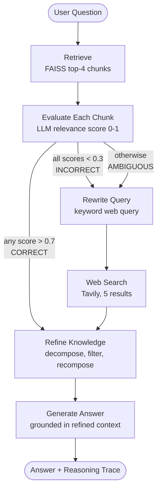

# Interview Preparation Assistant: Corrective RAG

An AI tutor that answers computer science interview questions **grounded in textbooks**, and automatically **falls back to live web search** when the textbooks aren't enough. Built on a **Corrective RAG (CRAG)** pipeline with LangGraph, so every answer is checked for relevance before it is generated.


#### 🔗 Live Demo: (https://khushimishra-26-corrective-rag-streamlit-app-q5dqzr.streamlit.app/)

---

Standard RAG retrieves the top-k chunks and sends them to the LLM, whether or not they are relevant. Irrelevant context leads to hallucinated or off-topic answers. This project implements **Corrective RAG**, which adds a *self-check* to the pipeline:

1. **Grade** every retrieved chunk for relevance.
2. **Decide** whether the knowledge base is sufficient.
3. **Correct** the course by searching the web if it isn't.
4. **Refine** the context down to only the sentences that matter.
5. **Generate** an answer strictly from that cleaned context.

The UI exposes this reasoning, so you can see *why* each answer was produced.

---

## 🧩 Features

- **Multi-book knowledge base** covering core interview topics: Operating Systems, Computer Networks, Databases, Machine Learning, OOP/Design and Coding Interviews.
- **LLM-based retrieval evaluator** that scores each chunk from 0.0 to 1.0 with a structured JSON output.
- **Three-way decision logic** (Correct / Ambiguous / Incorrect) that controls the retrieval source.
- **Web-search fallback** with automatic query rewriting for better search results.
- **Sentence-level knowledge refinement** that filters noise before generation.
- **Grounded generation.** The tutor answers only from the refined context and says *"I don't know"* otherwise.
- **Transparent UI.** An expander shows the verdict, reason, rewritten web query, kept vs. total sentences, refined context and source links.
- **Persistent graph state** through a SQLite checkpointer, with a separate thread per user session.

---

## 🏗️ Architecture



### Pipeline nodes

| Node | Responsibility |
|---|---|
| `retrieve` | Semantic search over the FAISS index and return the top 4 chunks. |
| `eval_each_doc` | The LLM scores each chunk and the scores decide the verdict. |
| `rewrite_query` | Turns the question into a short keyword query (6 to 14 words) and adds a recency constraint when relevant. |
| `web_search` | Fetches up to 5 results through Tavily and wraps them as documents with title and URL metadata. |
| `refine` | Splits context into sentences, keeps only the relevant ones, and rebuilds a compact context. |
| `generate` | Produces the final answer using only the refined context. |

### Routing logic

| Verdict | Condition | Context used for refinement |
|---|---|---|
| 🟢 **CORRECT** | At least one chunk scores **> 0.7** | Filtered local chunks |
| 🔴 **INCORRECT** | All chunks score **< 0.3** | Web results only |
| 🟡 **AMBIGUOUS** | Anything in between | Local chunks that scored > 0.3, plus web results |

---

## 🧠 Concepts used in Corrective RAG

This project is based on the **Corrective Retrieval Augmented Generation** approach (Yan et al., 2024). The key ideas implemented here:

- **Retrieval Evaluator.** A lightweight LLM judge grades each chunk against the question, which turns retrieval quality into a measurable signal instead of an assumption.
- **Confidence thresholds.** The upper (0.7) and lower (0.3) thresholds split results into *Correct*, *Ambiguous* and *Incorrect*, so the system only trusts retrieval when it has earned it.
- **Corrective actions.** When local retrieval is weak, the system escalates to an external source (web search) instead of generating from poor context.
- **Query rewriting.** Natural-language questions are converted into search-engine-friendly keyword queries to improve web retrieval.
- **Decompose, Filter, Recompose.** Retrieved text is broken into sentence-level "strips", each strip is judged for relevance, and the survivors are merged into a clean context. This removes the noise inside otherwise relevant chunks.
- **Grounded generation.** The prompt restricts the model to the refined context and requires an explicit *"I don't know"* when evidence is missing, which reduces hallucination.
- **Stateful agent workflow.** The pipeline is modeled as a LangGraph state machine with typed state, conditional edges and checkpointing, which makes each step observable and easy to extend.
- **Structured outputs.** Pydantic schemas enforce valid JSON from the LLM for scores, keep/drop decisions and web queries.

---

## 🛠️ Tech Stack

| Layer | Technology |
|---|---|
| **Orchestration** | LangGraph, LangChain |
| **LLM** | Groq API, `openai/gpt-oss-120b` (temperature 0) |
| **Embeddings** | Hugging Face `sentence-transformers/all-MiniLM-L6-v2` |
| **Vector store** | FAISS |
| **Web search** | Tavily |
| **Document loading** | PyPDFLoader (`pypdf`) |
| **Text splitting** | `RecursiveCharacterTextSplitter` (500 characters, 100 overlap) |
| **Validation** | Pydantic |
| **State persistence** | SQLite (`SqliteSaver` checkpointer) |
| **Frontend** | Streamlit |
| **Language** | Python |

---

## 📚 Knowledge Base

The index is built from standard references across core CS interview topics:

- Operating System Concepts (Silberschatz, Galvin, Gagne)
- Operating Systems: Three Easy Pieces
- Computer Networks (Tanenbaum)
- Fundamentals of Database Systems (Elmasri, Navathe)
- Cracking the Coding Interview (Laakmann)
- Object-Oriented Analysis and Design with Applications (Booch)
- A Machine Learning e-book

---

## 📁 Project Structure

```
.
├── streamlit_app.py      # Streamlit frontend
├── rag_backend.py        # Corrective RAG pipeline (LangGraph)
├── docs/                 # Source PDFs (not committed)
├── requirements.txt
└── .streamlit/
    └── secrets.toml      # API keys (not committed)
```

---

## 🚀 Getting Started

### 1. Clone the repository

```bash
git clone https://github.com/<your-username>/<your-repo>.git
cd <your-repo>
```

### 2. Install dependencies

```bash
python -m venv venv
source venv/bin/activate        # Windows: venv\Scripts\activate
pip install -r requirements.txt
```

### 3. Add your documents

Place your PDFs in the `docs/` folder. The file names must match the paths in `rag_backend.py`, or you can edit the paths there.

### 4. Configure API keys

Create `.streamlit/secrets.toml`:

```toml
GROQ_API_KEY = "your-groq-key"
TAVILY_API_KEY = "your-tavily-key"
```

Get keys from [Groq Console](https://console.groq.com) and [Tavily](https://tavily.com).

### 5. Run the app

```bash
streamlit run streamlit_app.py
```

The first launch takes longer because the PDFs are embedded and indexed. After that, the index stays cached for the server's lifetime.

---

## 🔍 Example Flow

**Question:** *"How does the Banker's algorithm avoid deadlock?"*

1. The top 4 chunks are retrieved from the OS textbooks.
2. The evaluator scores them and at least one scores above 0.7, so the verdict is **CORRECT**.
3. The chunks are split into sentences and only the relevant ones are kept.
4. The answer is generated from those sentences alone.

**Question:** *"What are the latest trends in LLM inference optimization?"*

1. Textbook chunks all score below 0.3, so the verdict is **INCORRECT**.
2. The question is rewritten into a keyword query, for example with a "last 30 days" constraint.
3. Tavily returns web results, which are refined and used to generate the answer, with source links shown in the UI.

---

## ⚠️ Known Limitations

- **Latency.** The evaluator and filter run one LLM call per chunk or sentence, which favors accuracy over speed.
- **Chunk size.** 500-character chunks are small and can split concepts. Tuning chunk size and `k` could improve recall.
- **Fixed thresholds.** The 0.7 and 0.3 cutoffs are heuristic and have not been tuned on a labeled evaluation set.
- **Single-turn QA.** Each question is answered independently, without multi-turn conversational memory.

## 🔭 Future Improvements

- Parallelize evaluation and filtering calls to cut latency
- Persist the FAISS index to disk to speed up startup
- Add cross-encoder reranking and hybrid (BM25 + dense) retrieval
- Build an evaluation harness (answer faithfulness and relevance metrics) to tune the thresholds
- Add multi-turn memory and source citations inline in answers
- Stream tokens to the UI

---

## 📖 Reference

Yan, S.-Q., Gu, J.-C., Zhu, Y., Ling, Z.-H. (2024). *Corrective Retrieval Augmented Generation.* arXiv:2401.15884


---

If you found this project useful, consider giving it a star ⭐️
